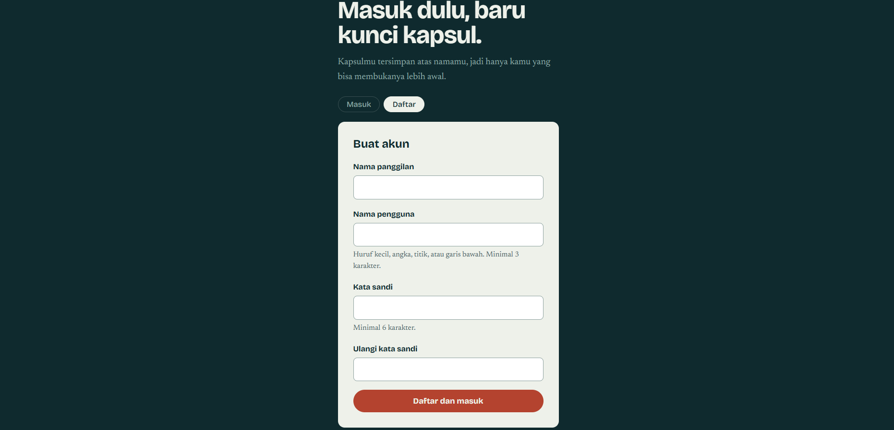
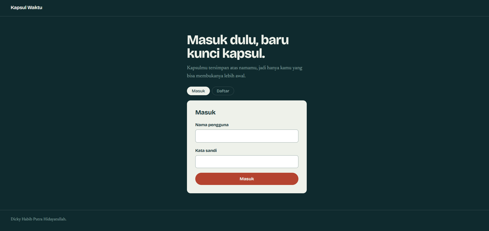
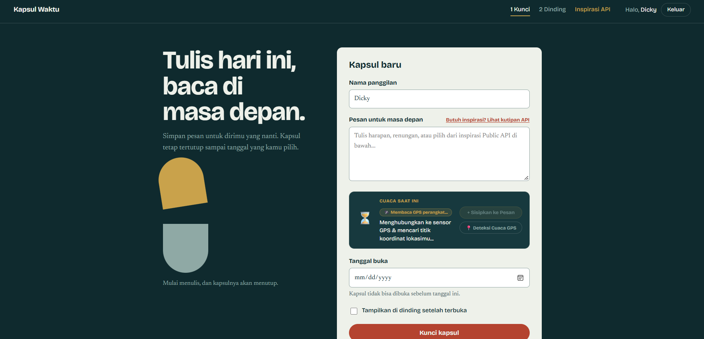
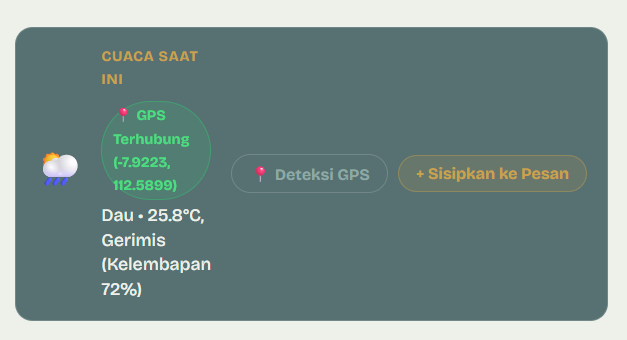
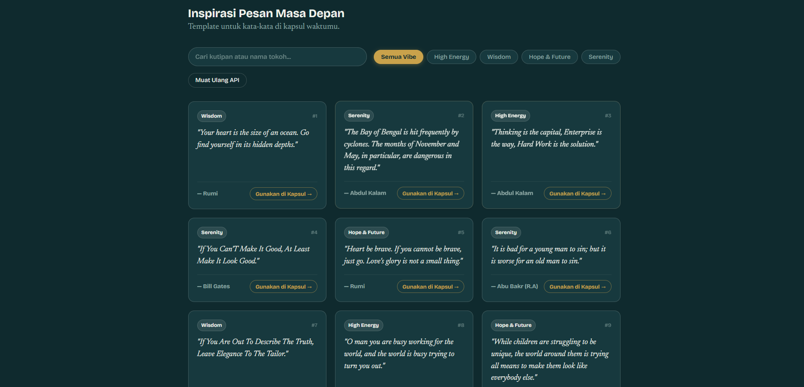
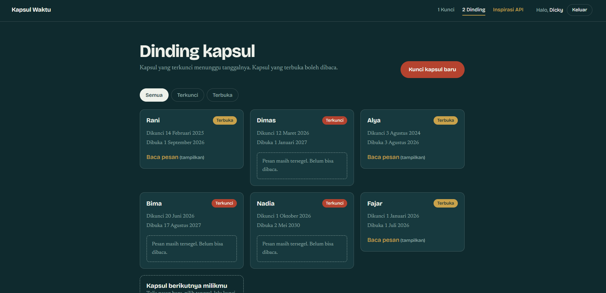
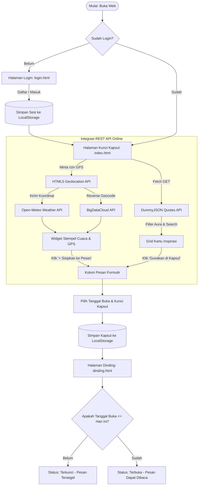

# ⏳ Kapsul Waktu — Simpan Pesan untuk Masa Depan

Aplikasi web interaktif **"Kapsul Waktu"** (*Time Capsule*) memungkinkan pengguna menulis surat atau pesan untuk diri mereka sendiri di masa depan. Pesan disegel secara digital dan hanya dapat dibuka setelah melewati tanggal yang telah ditentukan. Dilengkapi dengan **integrasi REST API Online gratis** untuk merekam cuaca & koordinat GPS saat kapsul dikunci, serta inspirasi kata-kata bijak masa depan.

Proyek ini dikembangkan sebagai pemenuhan **Tugas Pemrograman Web**.

---

## 📸 Preview Web & Tangkapan Layar Semua Menu

Berikut adalah dokumentasi tangkapan layar asli dari setiap menu dan halaman yang terdapat pada aplikasi web **Kapsul Waktu**:

### 1. Menu Autentikasi: Masuk Akun (`login.html`)
Halaman masuk bagi pengguna yang telah memiliki akun terdaftar. Dilengkapi validasi form dan pemeriksaan hash kata sandi SHA-256.
<p align="center">
  
</p>

---

### 2. Menu Autentikasi: Buat Akun Baru (`login.html`)
Tab registrasi untuk mendaftarkan akun baru (nama panggilan, nama pengguna unik, kata sandi, dan konfirmasi kata sandi).
<p align="center">
  
</p>

---

### 3. Menu 1: Kunci Kapsul Baru (`index.html`)
Halaman utama untuk membuat kapsul waktu. Menampilkan animasi kapsul fisik di sisi kiri serta formulir pembuatan kapsul di sisi kanan, lengkap dengan widget cuaca real-time.
<p align="center">
  
</p>

---

### 4. Detail Widget Cuaca Real-Time Berbasis GPS (Open-Meteo API)
Tampilan jarak dekat (*close-up*) widget stempel cuaca yang berhasil mendeteksi koordinat GPS riil perangkat (*Kecamatan Dau, Malang, 25.8°C Gerimis*) dengan susunan tombol aksi vertikal yang rapi.
<p align="center">
  
</p>

---

### 5. Bagian Inspirasi Pesan Masa Depan: Quotes API (`index.html#section-inspirasi`)
Fitur pengambilan kutipan inspirasi dari server Public API (DummyJSON) secara asinkronus via *Fetch GET*. Dilengkapi pencarian *real-time*, filter *Aura* suasana hati, dan tombol *Gunakan di Kapsul →*.
<p align="center">
  
</p>

---

### 6. Menu 2: Dinding Kapsul Waktu (`dinding.html`)
Halaman eksplorasi seluruh kapsul waktu yang tersimpan di sistem. Dilengkapi filter status (*Semua*, *Terkunci*, *Terbuka*). Pesan kapsul yang belum tiba tanggal bukanya akan tersegel dan tidak dapat dibaca.
<p align="center">
  
</p>

---

## ✨ Fitur-Fitur Utama

### 1. 🔐 Autentikasi Pengguna & Keamanan Lokal
* **Pendaftaran Akun & Masuk**: Pengguna dapat mendaftarkan akun baru dengan nama panggilan, *username*, dan kata sandi.
* **Keamanan Kriptografi**: Kata sandi di-*hash* menggunakan algoritma **SHA-256** melalui *Web Crypto API* (`window.crypto.subtle.digest`) sebelum disimpan di `localStorage`.
* **Proteksi Rute (*Route Guard*)**: Halaman formulir dan dinding kapsul otomatis mengarahkan pengunjung ke halaman `login.html` jika belum memiliki sesi aktif.

### 2. 📝 Kunci Kapsul Baru (`index.html`)
* **Formulir Interaktif**: Input nama panggilan, pesan masa depan, tanggal buka kapsul, serta opsi tampilkan di dinding publik.
* **Animasi Fisik Kapsul**: Animasi CSS visual kapsul yang otomatis menutup dan menyegel saat pengguna mulai mengetik isi pesan di formulir.
* **Validasi Tanggal Pintar**: Tanggal buka divalidasi minimal hari esok (`tomorrowISO()`) sehingga tidak dapat memilih tanggal lampau.

### 3. 🌤️ Stempel Cuaca Real-Time Berbasis Lokasi GPS (Open-Meteo API)
* **Sensor GPS Akurat**: Menggunakan **HTML5 Geolocation API** (`navigator.geolocation`) dengan opsi `enableHighAccuracy: true` untuk membaca titik garis lintang (*latitude*) dan garis bujur (*longitude*) perangkat.
* **Reverse Geocoding Otomatis**: Titik koordinat GPS diterjemahkan secara otomatis menjadi nama kota/kecamatan (contoh: *Dau, Malang*) menggunakan layanan gratis tanpa API key dari *BigDataCloud Client-side Geocoding*.
* **Live Weather Data**: Mengambil data suhu udara (°C), tingkat kelembapan (%), dan kondisi cuaca (cerah, berawan, gerimis, hujan) dari **Open-Meteo API**.
* **Tombol `+ Sisipkan ke Pesan`**: Sekali klik menyematkan stempel kondisi alam saat kapsul disegel ke dalam pesan, contoh:
  ```text
  [Stempel Cuaca Saat Kapsul Dikunci: 19 November 2026 • 📍 Dau (Lat: -7.9223, Lon: 112.5899) • 🌦️ 25.8°C, Gerimis (Kelembapan 72%)]
  ```
* **Tombol `📍 Deteksi Cuaca GPS`**: Memperbarui titik lokasi dan data cuaca terkini kapan saja.

### 4. 💡 Inspirasi Pesan Masa Depan (Quotes API)
* **REST API Fetch GET**: Mengambil 30 kutipan bijak dan nasihat masa depan dari server **DummyJSON Quotes API** menggunakan `async/await`.
* **Pencarian Real-Time**: Kolom pencarian instan untuk mencari kata kunci kutipan atau nama tokoh.
* **Filter Aura Suasana Hati**: Mengelompokkan kutipan ke dalam kategori:
  * `Semua Vibe`
  * `High Energy`
  * `Wisdom`
  * `Hope & Future`
  * `Serenity`
* **Tombol `Gunakan di Kapsul →`**: Menyalin kutipan langsung ke kolom pesan formulir dengan efek animasi *smooth highlight*.
* **State Management**: Dilengkapi indikator pemuatan (*loading spinner*) dan penanganan galat (*error handling*) dengan tombol coba lagi.

### 5. 📜 Dinding Kapsul Waktu (`dinding.html`)
* **Tampilan Kartu Dinamis**: Menyajikan daftar kapsul yang tersimpan.
* **Mekanisme Segel Waktu**:
  * **Kapsul Terkunci**: Ditandai badge merah *Terkunci*, pesan tetap tersegel rapat dan tidak dapat dibaca hingga tanggal buka tiba.
  * **Kapsul Terbuka**: Ditandai badge hijau *Terbuka*, pesan dapat dibuka dan dibaca isinya.
* **Filter Dinding**: Memfilter kartu berdasarkan status: *Semua*, *Terkunci*, dan *Terbuka*.

---

## 🔄 Alur Kerja Aplikasi (Workflow)



---

## 🌐 Rincian Integrasi REST API Online

Aplikasi ini menggunakan **2 Public API Online 100% Gratis** tanpa membutuhkan pendaftaran kartu kredit maupun API key:

| No | Layanan API | Endpoint URL | Fungsi dalam Proyek |
| :---: | :--- | :--- | :--- |
| **1** | **Open-Meteo Weather API** | `https://api.open-meteo.com/v1/forecast` | Mengambil suhu (°C), kelembapan (%), dan kode cuaca berdasarkan koordinat GPS pengguna. |
| **2** | **BigDataCloud Geocoding** | `https://api.bigdatacloud.net/data/reverse-geocode-client` | Menerjemahkan koordinat GPS (*lat/lon*) menjadi nama kota atau kecamatan secara otomatis. |
| **3** | **DummyJSON Quotes API** | `https://dummyjson.com/quotes?limit=30` | Mengambil kumpulan kata mutiara dan inspirasi masa depan untuk dimasukkan ke dalam kapsul waktu. |

---

## 📁 Struktur Berkas Proyek

```text
Tugas Pemrograman web/
│
├── index.html              # Halaman 1: Formulir kunci kapsul & widget API cuaca/quotes
├── dinding.html            # Halaman 2: Dinding eksplorasi kapsul terkunci & terbuka
├── login.html              # Halaman Autentikasi: Masuk & buat akun
├── script.js               # Seluruh logika JavaScript (API, LocalStorage, Geolocation, DOM)
├── style.css               # Seluruh desain visual & styling CSS responsif (Vintage / Steampunk)
├── README.md               # Dokumentasi lengkap proyek
│
└── assets/                         # Berkas gambar dokumentasi & tangkapan layar web
    ├── image-copy.png                  # Tangkapan layar Menu Autentikasi: Masuk Akun
    ├── image1.png                      # Tangkapan layar Menu Autentikasi: Buat Akun
    ├── image.png                       # Tangkapan layar Menu 1: Kunci Kapsul Baru
    ├── preview-cuaca-gps.png           # Tangkapan layar Detail Widget Cuaca & GPS
    ├── image2.png                      # Tangkapan layar Bagian Inspirasi Quotes API
    └── image3.png                      # Tangkapan layar Menu 2: Dinding Kapsul Waktu
```

---

## 🚀 Panduan Menjalankan Proyek

1. **Unduh / Kloning Repositori**:
   Pastikan seluruh berkas berada di dalam satu folder yang sama.
2. **Buka dengan Browser**:
   * **Cara 1 (Rekomendasi)**: Buka folder menggunakan **VS Code**, lalu klik kanan pada berkas `login.html` dan pilih **"Open with Live Server"**.
   * **Cara 2**: Klik ganda (*double-click*) berkas `login.html` untuk langsung membukanya di peramban web (Google Chrome, Microsoft Edge, atau Mozilla Firefox).
3. **Izinkan Akses GPS Lokasi**:
   * Saat halaman formulir terbuka, browser akan memunculkan dialog perizinan: *"Know your location" / "Ketahui lokasi Anda"*.
   * Pilih **"Allow" / "Izinkan"** agar widget cuaca dapat langsung membaca titik GPS dan menyajikan cuaca akurat di daerahmu.

---

## 🛠️ Teknologi yang Digunakan

* **HTML5**: Semantik modern (`<header>`, `<nav>`, `<main>`, `<section>`, `<article>`, `<details>`, `<summary>`).
* **CSS3**:
  * *CSS Variables / Custom Properties* untuk skema tema warna yang konsisten (`--ink`, `--brass`, `--paper`, `--mist`, `--wax`).
  * *CSS Flexbox* & *CSS Grid Layout* untuk tata letak yang rapi.
  * Animasi CSS Keyframes & *smooth scrolling*.
  * *Media Queries* untuk tampilan responsif di layar ponsel (*mobile-friendly*).
* **JavaScript (Vanilla ES6+)**:
  * `Fetch API` & `async / await` untuk komunikasi data asinkronus ke server REST API.
  * `HTML5 Geolocation API` untuk membaca sensor lokasi GPS perangkat.
  * `Web Crypto API` (`SubtleCrypto SHA-256`) untuk keamanan kata sandi.
  * ES6 *Template Literals*, *Destructuring*, dan *Arrow Functions*.
  * Array Methods: `map()`, `filter()`, `find()`, dan *Event Delegation*.
  * `localStorage API` untuk penyimpanan data klien yang persisten.

---

## 👨‍💻 Pengembang

* **Nama**: Dicky Habib Putra Hidayatullah
* **Mata Kuliah**: Praktikum Pemrograman Web (Semester 5)
* **Tahun**: 2026

---
*Dibuat dengan dedikasi untuk menghubungkan kata-kata hari ini dengan kenangan di masa depan.*

